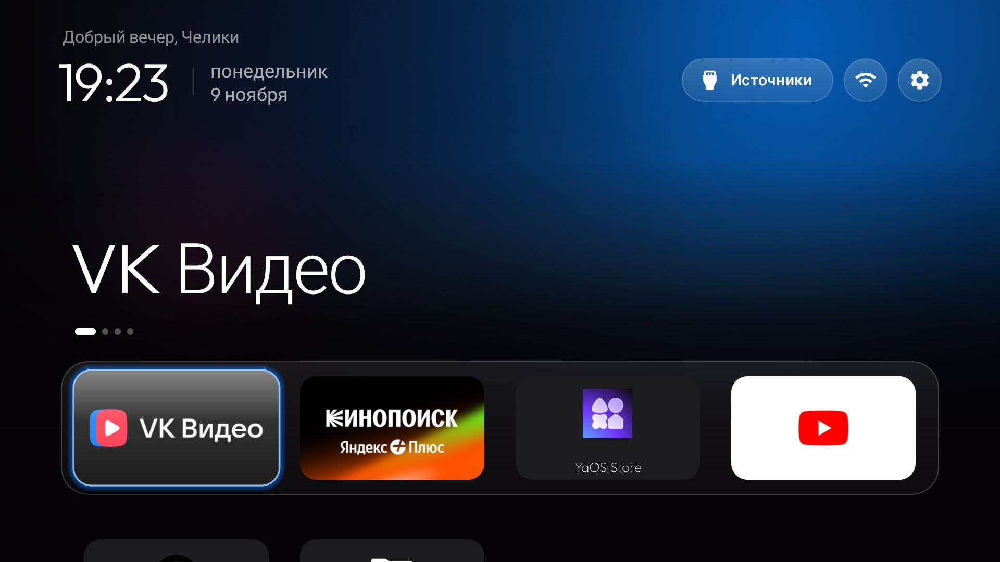

# Hartens quiet-header fork

A small, tested restyle of the CleanYourTV launcher for a 1080p Hartens HTY-43F11B-VS running Android 11 with 1 GB of RAM.



## What changes

- Greeting and two-line date use normal case, Outfit Regular and tighter spacing.
- Greeting is 16sp; the date is 18sp with no added line gap.
- The clock/date divider is vertically centred.
- The cinematic shelf omits both the “Last opened” metadata and the animated position dots.
- Icon-only app cards keep their single focused name below the card; the duplicate in-card caption is hidden.
- The dock derives horizontal and vertical padding from the active focus zoom and actual card size, leaving an
  exact 10dp post-focus clearance on all four sides (20px at the Hartens TV's 320dpi density).
- Focus uses a crisp 2dp app-coloured rim with no blurred halo, glass fill or specular sheen.
- The top button row has equal 56dp top and right insets at 1920×1080.
- Everything else stays on the upstream CleanYourTV launcher.

The launcher remains offline and adds no permissions, dependencies, services or background work.

## Tested on

- TV: Hartens HTY-43F11B-VS
- Android: 11
- Display: 1920×1080, density 320 dpi
- Memory: 1 GB
- Launcher package: `com.gathin.tvhome`
- Base: upstream CleanYourTV main at `294d3d59dc2514e69fed557f46c1ecdfb87a95ec`
- Runtime check: default Home retained, no launcher crashes, about 49 MB total PSS

## Build

Use the upstream launcher build:

```sh
cd launcher
JAVA_HOME=/path/to/jdk-17 ANDROID_HOME=/path/to/android-sdk \
  ./gradlew --no-daemon testReleaseUnitTest lintRelease assembleRelease
```

Install over an existing build signed with the same debug key:

```sh
adb install -r launcher/app/build/outputs/apk/release/app-release.apk
```

The fork publishes source only. No prebuilt APK is committed.

